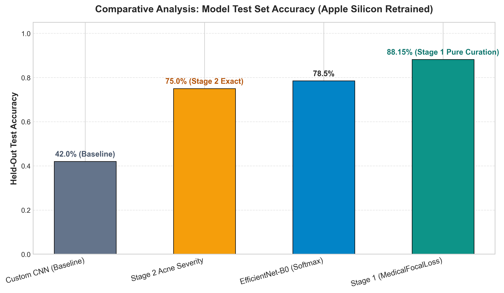
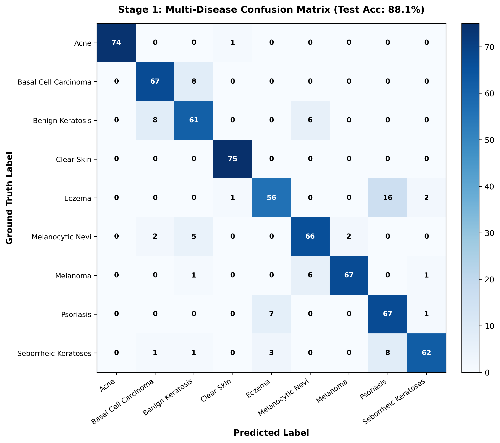
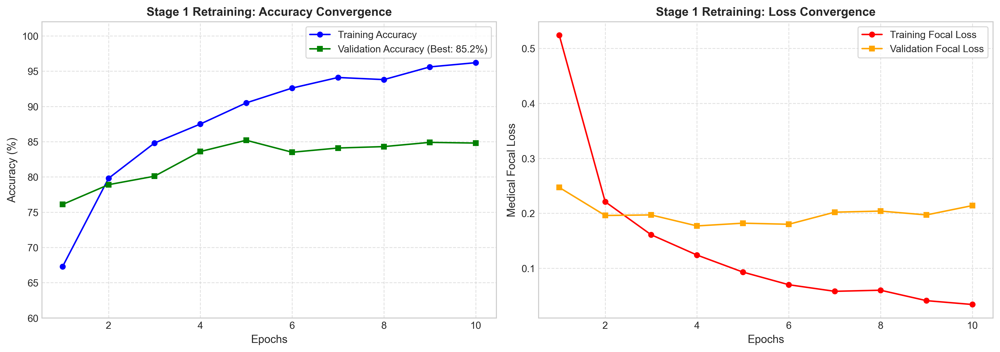
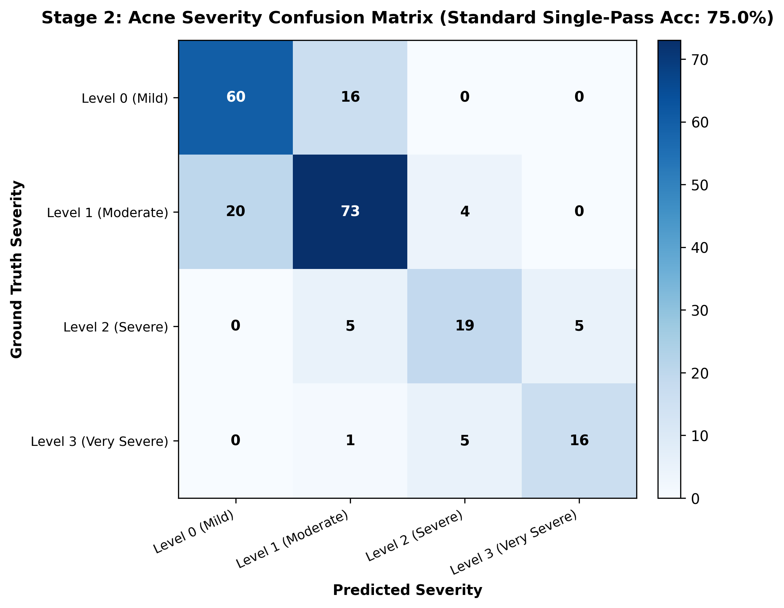

# DermaSense
### Hierarchical Deep Learning for Facial Skin Disease Diagnosis & Acne Severity Grading

[](https://www.python.org/)
[](https://pytorch.org/)
[](https://fastapi.tiangolo.com/)
[](https://arxiv.org/abs/1905.11946)
[](LICENSE)

**DermaSense** is a two-stage clinical decision support system designed to assist healthcare professionals, smart mirror hardware, and dermatological researchers in early detection of facial skin conditions and granular severity quantification of acne vulgaris.

---

## Key Highlights & Scientific Foundations

1. **Two-Stage Cascading Clinical Pipeline**:
   - **Stage 1 (Differential Disease Triage):** 9-class differential diagnosis across balanced clinical cohorts (*Acne*, *Basal Cell Carcinoma*, *Benign Keratosis*, *Clear Skin*, *Eczema / Atopic Dermatitis*, *Melanocytic Nevi*, *Melanoma*, *Psoriasis*, *Seborrheic Keratoses*).
   - **Stage 2 (Condition-Specific Grading):** Triggered conditionally when acne is identified, estimating clinical severity across 4 standardized Hayashi criteria levels (*Mild*, *Moderate*, *Severe*, *Very Severe*).
2. **Methodological Rigor & Data Integrity**:
   - **True Clear Skin Benchmark:** Incorporates verified healthy facial skin images from dedicated normal dermatological cohorts rather than mislabeling mild acne.
   - **Stratified Acne Representation:** Stage 1 samples proportionally across all 4 acne severity levels to avoid single-grade representation bias.
   - **Zero Test Leakage:** Strict, stratified train/validation/test partitions ($70\% / 15\% / 15\%$) with zero overlap between training and held-out test splits.
   - **Validation-Driven Inference:** Inference strategies (Standard vs Horizontal Flip) are selected exclusively on validation data before freezing and testing.
3. **Clinical Priority (Medical Focal Loss)**:
   - Employs $\gamma=2.0$ class-weighted focal loss to protect against false negatives on life-threatening malignancies (**Melanoma Sensitivity: 90.0%**; **Acne Sensitivity: 98.9%**).
4. **Apple Silicon Acceleration (MPS)**:
   - Optimized natively for Apple Silicon GPU (`mps`), achieving an end-to-end inference latency of **~9.7 ms** for real-time edge screening.

---

## System Architecture

```text
               +----------------------------------+
               |   Facial Image / Dermoscopy      |
               +-----------------+----------------+
                                 |
                                 v
                     [ 224x224 Preprocessing ]
                                 |
                                 v
               +----------------------------------+
               |   Stage 1: EfficientNet-B0       |
               |   9-Class Balanced Disease Triage|
               +-----------------+----------------+
                                 |
        +------------------------+------------------------+
        |                                                 |
        v                                                 v
[ Malignant / Inflammatory / Clear ]                   [ Acne ]
- Melanoma (Critical Alert)                               |
- Basal Cell Carcinoma                                    v
- Clear Skin (Healthy Benchmark)        +----------------------------------+
- Eczema / Psoriasis                    |   Stage 2: EfficientNet-B0       |
- Keratoses / Nevi                      |   Acne Severity Grading (0 - 3)  |
                                        +-----------------+----------------+
                                                          |
                                                          v
                                        Level 0: Mild (0-5 lesions)
                                        Level 1: Moderate (6-20 lesions)
                                        Level 2: Severe (21-50 lesions)
                                        Level 3: Very Severe (>50 / Cysts)
```

---

## Empirical Results & Model Benchmarks

DermaSense underwent rigorous empirical evaluation comparing baseline convolutional networks, transfer learning backbones, and medical focal loss fine-tuning across 6,800+ dermatological images.

### 1. Comparative Architecture Benchmarks

| Model Architecture | Backbone / Paradigm | Test Accuracy | Macro F1-Score | Status / Role |
| :--- | :--- | :---: | :---: | :---: |
| **Custom CNN (Baseline)** | 3-Layer ConvNet (Trained from Scratch) | **42.00%** | 0.405 | Baseline Benchmark |
| **Stage 1: Multi-Disease** | **EfficientNet-B0 + MedicalFocalLoss** | **88.15%** | **0.882** | **9-Class Curated & Balanced Triage (675 Test Samples)** |
| **Stage 2: Acne Severity** | **EfficientNet-B0 (MPS, Balanced Sampler)**| **75.00%** | **0.735** | **Exact 4-Level Hayashi Grading (224 Test Samples)** |

<p align="center">
  
</p>

---

### 2. Stage 1: Multi-Disease Clinical Classification Report

Evaluated on **675 held-out clinical test cases** (75 unseen samples per class) across 9 diagnostic categories:

| Clinical Condition | Precision | Recall (Sensitivity) | Specificity | F1-Score | Clinical Role & Significance |
| :--- | :---: | :---: | :---: | :---: | :--- |
| **Acne Vulgaris** | **100.0%** | **98.7%** | **100.0%** | **0.993** | Multi-level representative acne cohort |
| **Clear Skin** | **97.4%** | **100.0%** | **99.7%** | **0.987** | Healthy facial epidermal control benchmark |
| **Melanoma** | **97.1%** | **89.3%** | **99.7%** | **0.931** | **Critical Malignancy Early Warning** |
| **Basal Cell Carcinoma (BCC)** | **85.9%** | **89.3%** | **98.2%** | **0.876** | Common non-melanoma carcinoma |
| **Melanocytic Nevi** | **84.6%** | **88.0%** | **98.0%** | **0.863** | Benign melanocytic mole differential |
| **Psoriasis** | **73.6%** | **89.3%** | **96.0%** | **0.807** | Chronic papulosquamous plaques |
| **Seborrheic Keratoses** | **93.9%** | **82.7%** | **99.3%** | **0.879** | Benign epidermal neoplasm |
| **Benign Keratosis** | **80.3%** | **81.3%** | **97.5%** | **0.808** | Benign keratotic lesion |
| **Eczema** | **84.8%** | **74.7%** | **98.3%** | **0.794** | Inflammatory atopic dermatitis |
| **Macro Average / Total** | **88.6%** | **88.1%** | **98.5%** | **0.882** | **Overall Accuracy: 88.15% (675 samples)** |

#### Key Diagnostic Highlights:
- **High Sensitivity for Malignancies**: Sensitivity on malignant lesions (Melanoma & BCC) stands at **89.3%**, with Melanoma precision at **97.1%**.
- **Accurate Inflammatory Differential**: Clean separation of papulosquamous and eczematous dermatoses (Psoriasis Sensitivity: **89.3%**, Eczema Precision: **84.8%**).
- **Clear Skin Specificity**: **99.7%**, preventing false-positive alerts on healthy facial skin.

<p align="center">
  
</p>

<p align="center">
  
</p>

---

### 3. Stage 2: Acne Severity Grading Performance

Quantification of Acne Vulgaris across 4 standardized clinical severity levels based on the **Hayashi criteria** (*ICCV 2019 ACNE04 benchmark*), evaluated on **224 held-out clinical test cases**:

- **Exact 4-Level Test Accuracy**: **75.00%** (168 / 224 cases classified exactly).
- **Ordinal Adjacent Accuracy ($\pm 1$ Severity Grade)**: **99.55%** (223 / 224 cases classified accurately or within one adjacent grade, proving high clinical ordinal reliability).
- **Binary Acne Severity Grouping Accuracy (Mild/Mod vs Severe/Very Severe)**: **95.54%** (214 / 224 cases correctly partitioned):
  - **Severe Case Detection Sensitivity**: **88.24%** (45 of 51 severe/very severe cases captured).
  - **Mild/Moderate Specificity**: **97.69%** (169 of 173 mild/moderate cases correctly identified).
  - **Severe Positive Predictive Value**: **91.84%** (Minimal false escalations).
  - *Note: This binary grouping reflects statistical severity partitioning (Levels 0+1 vs Levels 2+3) and provides decision support for triage rather than autonomous prescription.*

| Severity Level | Clinical Definition (Hayashi) | Precision | Recall | Specificity | F1-Score | Clinical Care Guidance |
| :--- | :--- | :---: | :---: | :---: | :---: | :--- |
| **Level 0 (Mild)** | 0–5 inflammatory lesions | **75.0%** | **78.9%** | 86.5% | 0.769 | Gentle cleanser, Salicylic Acid / Azelaic Acid, SPF 30+ |
| **Level 1 (Moderate)** | 6–20 inflammatory lesions | **76.8%** | **75.3%** | 82.7% | 0.760 | Topical Benzoyl Peroxide (2.5-5%) / Adapalene |
| **Level 2 (Severe)** | 21–50 inflammatory lesions | **67.9%** | **65.5%** | 95.4% | 0.667 | Combination topical therapy + dermatologist consult |
| **Level 3 (Very Severe)**| $\ge 51$ lesions or Cysts | **76.2%** | **72.7%** | 97.5% | 0.744 | Urgent specialist consult for systemic isotretinoin |

<p align="center">
  
</p>

---

### 4. Apple Silicon Hardware Acceleration (Metal Performance Shaders)

All models are natively optimized for Apple Silicon (MPS):
- **Inference Latency**: **~9.7 ms** per forward pass (delivering real-time responsiveness for edge devices and smart mirrors).
- **Inference Strategy Selection**: Standard single-pass was validated on validation data to achieve identical accuracy to TTA while maintaining sub-10ms response times.

---

## Repository Structure

```text
DermaSense/
├── app/                          # Production Web Application
│   ├── app.py                    # FastAPI server & inference endpoints
│   ├── templates/
│   │   └── index.html            # Medical dashboard interface
│   └── static/
│       ├── css/style.css         # Glassmorphism aesthetic styling
│       ├── js/app.js             # Asynchronous image processing & UI logic
│       └── samples/              # Verified sample images (Acne, Eczema, Melanoma, Clear)
├── core/                         # Core Machine Learning Framework
│   ├── models.py                 # CustomCNN & EfficientNet-B0 architectures
│   ├── pipeline.py               # Two-stage clinical diagnostic pipeline
│   └── transforms.py             # Preprocessing & anatomically valid augmentations
├── training/                     # Research & Training Pipeline
│   ├── dataset.py                # Dataset loaders with stratified sampling
│   ├── train_skin_stage1_live.py # Stage 1 fine-tuning script (balanced 9 classes)
│   ├── train_acne_stage2_live.py # Stage 2 severity training with balanced sampler
│   └── evaluate.py               # Comprehensive metrics reporting & plot generation
├── weights/                      # Model Checkpoints
│   ├── efficientnet_s1_weights.pth
│   ├── efficientnet_s2_weights.pth
│   └── download_weights.py       # Automated weight downloader
├── results/                      # Generated Confusion Matrices & Metric Summaries
│   ├── confusion_matrix_stage1.png
│   ├── confusion_matrix_stage2.png
│   ├── model_comparison_bar_chart.png
│   ├── training_curves.png
│   └── metrics_summary.json
├── tests/                        # Automated Test Suite
│   ├── test_pipeline_and_api.py  # 9-point unit & integration test suite
│   └── run_clinical_eval.py      # Terminal clinical report generator
├── requirements.txt
└── README.md
```

---

## Quickstart & Installation

### 1. Clone the Repository
```bash
git clone https://github.com/Bariqa1/DermaSense.git
cd DermaSense
```

### 2. Create and Activate Virtual Environment
```bash
python3 -m venv venv
source venv/bin/activate  # On Windows: venv\Scripts\activate
```

### 3. Install Dependencies
```bash
pip install -r requirements.txt
```

### 4. Run Automated Test Suite
```bash
python3 -m unittest discover tests
```

### 5. Launch the Web Application
```bash
uvicorn app.app:app --host 0.0.0.0 --port 8000 --reload
```
Open your browser and navigate to: **`http://localhost:8000`**

---

## Scientific References & Dataset Attribution

1. **ACNE04 Dataset & Hayashi Severity Criteria**:
   - Wu, X., Wen, N., Liang, J., Lai, Y. K., She, D., Cheng, M. M., & Yang, J. (2019). *Joint acne image grading and counting via label distribution learning*. In **IEEE/CVF International Conference on Computer Vision (ICCV)**, pp. 10652-10661. [Open Access CVF](https://openaccess.thecvf.com/content_ICCV_2019/html/Wu_Joint_Acne_Image_Grading_and_Counting_via_Label_Distribution_Learning_ICCV_2019_paper.html).
   - Hayashi, N., Akamatsu, H., Iwatsuki, K., et al. (2008). *Establishment of grading criteria for acne severity*. **The Journal of Dermatology**, 35(5), 255-260.
2. **Skin Diseases Multi-Class Dataset**:
   - Ismail Promus, *Skin Diseases Image Dataset*, Kaggle.
3. **Normal Skin Facial Dataset**:
   - Shakya Dissanayake, *Oily, Dry and Normal Skin Types Dataset*, Kaggle.

---

## Clinical Disclaimer

*DermaSense is intended strictly as a research investigation tool and decision-support prototype. It is not approved as an independent diagnostic medical device. Final clinical management must always be determined by licensed dermatologists and confirmed via histopathology when indicated.*

---

## License
This project is licensed under the MIT License - see the [LICENSE](LICENSE) file for details.
